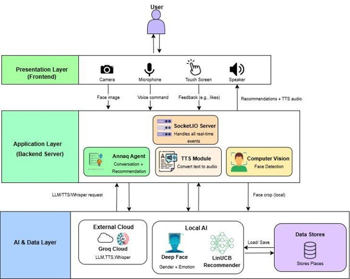

# Annaq

> **A culturally-aware AI tourism companion that transforms destination discovery into an interactive, personalized conversation.**


## Overview

**Annaq** is an AI-powered tourism companion designed to make discovering destinations in Saudi Arabia more engaging and personalized.

Instead of relying on traditional recommendation systems where users passively browse through options, Annaq interacts with visitors through conversation, understands their preferences and context, and generates personalized recommendations.

The system combines **conversational AI, computer vision, speech technologies, and an adaptive recommender system** into a single interactive kiosk experience.


---

## The Problem

Traditional recommendation systems often make content discovery a passive and time-consuming process. Users are presented with lists of options and are expected to search, filter, and decide for themselves.

We wanted to explore a different approach:

**What if a recommendation system could actually talk to you, understand what you want, and make the discovery process feel more natural?**

This led to the idea of Annaq — a digital companion designed to make recommendations feel more like a conversation than a search.

---

## Our Solution

Annaq combines multiple AI technologies to create a more interactive recommendation experience.

The system can:

* Understand natural language
* Communicate using a Saudi Arabic personality
* Analyze facial expressions and contextual information
* Extract preferences such as city and mood
* Generate personalized destination recommendations
* Learn from user feedback
* Present recommendations through an interactive kiosk interface

The goal was not simply to build another chatbot, but to create a **personality-driven digital companion with a culturally authentic identity**.

---

## How It Works



### 1. User Interaction

The visitor interacts with Annaq through voice and the touchscreen interface.

### 2. Understanding the User

Annaq processes the conversation and extracts useful information such as the visitor's **city, mood, and preferences**.

Computer vision can also provide contextual information such as facial emotion.

### 3. Context Building

The extracted information is converted into a contextual representation that can be passed to the recommendation system.

### 4. Adaptive Recommendation

The recommender evaluates available destinations using a hybrid approach combining **LinUCB (Contextual Bandits)** with static similarity.

### 5. Personalized Results

Annaq presents the highest-ranked destinations through interactive recommendation cards.

### 6. User Feedback

Visitors can interact with recommendations using the feedback controls.

Positive feedback can update the recommender, allowing future recommendations to become more relevant.

---

## My Role

### Team Lead · Frontend Developer · AI & Recommender Developer

#### Team Leadership

* Coordinated the development process across different project components
* Distributed and followed up on development tasks
* Helped connect the work of different team members
* Contributed to system-level decisions and integration

#### Frontend Development

* Worked on the interactive kiosk interface
* Implemented the user interaction flow
* Worked on displaying Annaq's responses and recommendation cards
* Contributed to the overall user experience of the system

#### Web & System Integration

* Connected the frontend with the backend and AI components
* Worked on communication between the web interface and Annaq's agent
* Integrated the recommendation results into the frontend experience
* Worked with real-time communication between the browser and backend

#### AI Agent Integration

* Worked on integrating Annaq's conversational agent with the rest of the system
* Connected natural-language understanding with the recommendation pipeline
* Worked with extracting information such as **city and mood** from user conversations
* Helped maintain Annaq's Saudi Arabic personality and conversational behavior

#### Recommender System

* Worked on the adaptive recommendation mechanism using **LinUCB**
* Worked with contextual user information and destination features
* Integrated user feedback into the recommendation process
* Contributed to the hybrid recommendation approach combining LinUCB with static similarity

---

## Key Features

### 🤖 Conversational AI

Annaq understands natural-language input and responds conversationally rather than relying only on predefined buttons.

### 🇸🇦 Saudi Personality

Annaq was designed with a culturally authentic Saudi identity, including a friendly Saudi Arabic conversational style.

### 🎯 Personalized Recommendations

Recommendations are generated based on contextual information such as the user's city, mood, and preferences.

### 🧠 Adaptive Recommender

The hybrid **LinUCB + static similarity** recommender can learn from user feedback while still providing reasonable recommendations for new interactions.

### 👁️ Computer Vision

Facial analysis is used to detect contextual information such as gender and emotion.

### 🎙️ Voice Interaction

Speech recognition allows visitors to communicate with Annaq naturally.

### ⚡ Real-Time Interaction

The frontend and backend communicate through Socket.IO, allowing text, audio, and visual elements to be synchronized during the interaction.

### 🗺️ Destination Exploration

Users can explore recommended destinations, view additional information, and open their location through Google Maps.

---

## AI & Recommendation System

Annaq brings together several AI components into one system:

### Llama 4 + Groq

The conversational agent uses **Llama 4**, served through the Groq API, to understand user messages and generate responses.

The agent is also constrained through prompt design and dialect normalization to maintain Annaq's personality and Saudi Arabic communication style.

### Speech Recognition

**Whisper** is used for speech-to-text processing, allowing visitors to communicate with Annaq through voice.

### Computer Vision

**DeepFace** is used for facial analysis, providing gender and emotion information that can contribute to the personalized interaction.

### Adaptive Recommendation

The recommendation system uses **LinUCB (Linear Upper Confidence Bound)**, a contextual bandit algorithm.

The system builds a contextual representation from information gathered during the interaction and uses it to rank available destinations.

A hybrid static-similarity component was added to improve recommendations during the cold-start stage.

### Feedback Loop

When a user interacts positively with a recommendation, the recommender can use that feedback as a reward signal and update its model.

This creates a feedback loop:

**User Context → Recommendation → User Feedback → Model Update → Future Recommendations**

The implemented recommender works with approximately **200 destinations**, uses a **36-dimensional context vector**, and achieved an average recommendation scoring time of around **0.2 seconds** during testing.

---

## System Architecture


Annaq consists of several interconnected components:

```text
                    ┌──────────────────┐
                    │      Visitor     │
                    └────────┬─────────┘
                             │
                    Voice / Touch / Camera
                             │
                             ▼
                    ┌──────────────────┐
                    │   Annaq Frontend │
                    └────────┬─────────┘
                             │
                       Real-Time
                       Communication
                             │
                             ▼
                    ┌──────────────────┐
                    │   Annaq Agent    │
                    └────────┬─────────┘
                             │
              ┌──────────────┼──────────────┐
              ▼              ▼              ▼
          LLM / NLP      Computer       Context
                         Vision          Extraction
              │              │              │
              └──────────────┼──────────────┘
                             │
                             ▼
                    ┌──────────────────┐
                    │   Recommender    │
                    │ LinUCB + Similarity│
                    └────────┬─────────┘
                             │
                             ▼
                    Personalized Places
                             │
                             ▼
                         Feedback
                             │
                             └──────► Model Update
```

---

## Design & Identity

Annaq's identity was inspired by the **Caracal**, known in Arabic as *Annaq Al-Ard*.

The caracal was chosen because of its connection to the Saudi desert and its ability to represent the project's goal of combining **Saudi identity, technology, and modern visual design**.

The visual identity uses reddish and sandy tones inspired by the animal and its natural environment.


---

## Screenshots

### Main Interface


### Conversation


### Personalized Recommendations


### Destination Details


---

## Demo

### 🎥 Watch Annaq in Action

[](YOUR_DEMO_LINK)

The demo demonstrates the complete interaction flow, from the initial greeting and conversation to personalized recommendations and user feedback.

---

## Tech Stack

### Frontend

* JavaScript
* HTML / CSS
* Socket.IO Client

### Backend

* Python
* aiohttp
* Socket.IO

### AI & Machine Learning

* Llama 4
* Groq API
* Whisper
* DeepFace
* LinUCB
* Contextual Bandits

### Data & Processing

* CSV-based destination dataset
* NumPy
* Pickle

### Development & Design

* Git
* GitHub
* Figma

---

## Challenges & Solutions

### Making Recommendations Useful from the First Interaction

A pure learning-based recommender can struggle when there is little previous feedback.

**Solution:**
We combined LinUCB with a static similarity score to provide sensible recommendations even during the cold-start stage.

### Connecting Multiple AI Components

Annaq combines conversational AI, speech recognition, text-to-speech, computer vision, and recommendation components.

**Solution:**
We designed the system as interconnected modules and used real-time communication to synchronize the different components.

### Real-Time Performance

The system needed to provide recommendations quickly enough to maintain a smooth interaction.

**Result:**
Testing showed an average overall response time of approximately **3.2–3.4 seconds**, remaining below the project's 5-second requirement.

---

## Testing & Results

Annaq was evaluated through unit, integration, system, and acceptance testing.

The final acceptance tests covered:

* Voice-based recommendations
* Destination details
* User feedback
* Conversational small talk
* Session termination
* Response performance

The average response time was approximately **3.2 seconds**, meeting the project's performance requirement.

The system also successfully demonstrated the integration of:

* Whisper speech recognition
* Llama 4 conversational AI
* Orpheus text-to-speech
* DeepFace computer vision
* Hybrid LinUCB recommendation
* Socket.IO real-time communication

---

## Future Improvements

### 🌍 Multilingual Support

Add English, Urdu, and French interfaces with automatic language switching.

### 👧 Child-Aware Interaction

Use age estimation to adapt vocabulary, tone, and interaction style for younger visitors.

### 🌤️ Context-Aware Recommendations

Integrate real-time weather and location data to recommend destinations based on current conditions.

### 📅 Event Awareness

Integrate seasonal and event information, such as Riyadh Season and Ramadan, to make recommendations more context-aware.

### 🔐 Improved Security & Privacy

Introduce explicit camera consent, a clear privacy policy, and encrypted communication for public deployments.

---

## What I Learned

Working on Annaq gave me experience beyond implementing individual features.

I learned how to:

* Lead a multidisciplinary software project
* Integrate AI components into a real interactive application
* Connect frontend and backend systems
* Work with conversational AI and LLM APIs
* Build and integrate an adaptive recommender
* Work with contextual bandit algorithms
* Design an AI experience around a specific cultural identity
* Handle real-time communication between system components
* Think about AI privacy and deployment constraints
* Test and validate an integrated AI system

Most importantly, Annaq taught me how different technical components need to work together as **one user experience**, rather than existing as isolated features.
